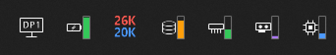
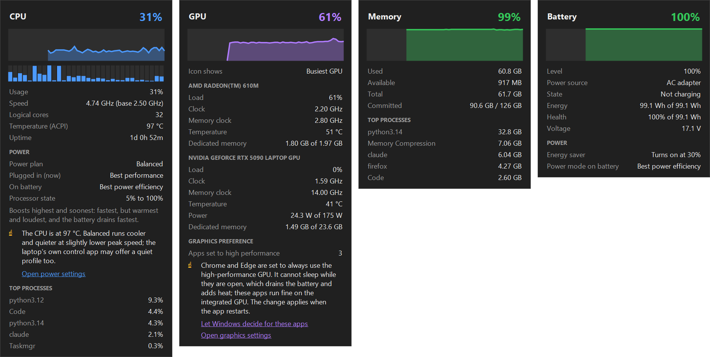

<h1 align="center">WinStats</h1>

<p align="center">
  A tiny system monitor for the Windows 11 taskbar, inspired by
  <a href="https://github.com/exelban/stats">Stats for macOS</a>.<br>
  One tray icon per module with a live value; a click opens the details.
</p>

<p align="center">
  
</p>

<p align="center">
  <a href="https://github.com/AnimaInCorpore/WinStats/releases/latest"><b>Download WinStats.exe</b></a>
  &nbsp;·&nbsp; single file, about 90 KB &nbsp;·&nbsp; nothing to install<br>
  <sub>The exe is not code-signed, so Windows SmartScreen may warn on first start
  (<i>More info → Run anyway</i>).</sub>
</p>

<p align="center">
  
</p>

It is a single C# file with no dependencies beyond what ships with Windows.

> **Created solely by AI.** All code and documentation in this repository were
> written by an AI (Claude, via Claude Code) from short prompts; no line was
> written by hand. It has been tried on one machine only, so treat it
> accordingly.

## Modules

|     | Module  | Tray icon shows | Click opens |
|:---:|---------|-----------------|-------------|
|  | **CPU** | Total load or temperature | History, per-core bars, clock speed, temperature, uptime, power plan and mode with hints, top processes |
|  | **GPU** | Load or temperature of the busiest (hottest) GPU, or of the one you pick | History; per GPU by name: load, clock, memory clock, temperature, power (NVIDIA), fan where reported, dedicated memory; per-app graphics preference hints |
|  | **Memory** | Used RAM in % | History, used / available / committed, top processes |
|  | **Disk** | Used space, active time or temperature of the system drive | Read/write speed, active time, free space of all drives, drive temperatures |
|  | **Network** | Upload (red) and download (blue) speed | History, interface, local IP, totals since start |
|  | **Battery** | Charge in % | History, power source, state, time remaining, charge/discharge power, energy, health, voltage, cycle count, energy saver, power mode on battery |
|  | **Bluetooth** | Lowest battery level of the connected devices | Battery level of each paired headset or other device that reports one |
|  | **Display** | Active monitor input (e.g. `DP1`) | A menu to switch the monitor's input source |

The battery module only appears on machines with a battery, the Bluetooth module
only when a paired device has reported a battery level.

## Usage

Start `WinStats.exe`. Windows 11 usually puts new tray icons into the overflow
flyout (the `^` arrow): drag them onto the taskbar, or enable them under
*Settings → Personalization → Taskbar → Other system tray icons*.

- **Left-click** an icon: details popup (Display: input menu). Click elsewhere or press `Esc` to close.
- **Right-click** any icon:
  - **Modules** – switch individual icons on or off
  - **Widget** – how the icons are drawn (see below)
  - **Icon shows** – CPU: load or temperature; GPU: load or temperature; Disk: used space, active time or temperature
  - **GPU shown** – which graphics adapter the GPU icon follows: the busiest one (default) or a specific GPU
  - **Update interval** – 1, 2 or 5 seconds
  - **Start with Windows**
  - **Task Manager**, **Quit WinStats**

### Widget styles

Pick one under right-click → **Widget**. Each row shows, from left to right:
CPU, GPU, memory, disk, network, battery, Bluetooth and display.

| Style | Looks like | Icon shows |
|-------|------------|------------|
| **Mini** |  | Three-letter label above the value |
| **Bar with letter** |  | First letter of the module next to a level bar |
| **Line chart** |  | Recent history as a small chart |
| **Bar with symbol** |  | Module symbol next to a level bar |
| **Symbol with value** |  | Module symbol above the value |
| **Segmented meters** |  | Module symbol above a five-step level meter |
| **Load rings** |  | Module symbol inside a circular level meter |
| **Large readings** |  | Large value above a color-coded module label |

The examples are drawn at twice the size of a tray icon on a 150 % display;
on the taskbar the icons are 16 px (100 %), 24 px (150 %) or 32 px (200 %).
The network icon always shows its two speeds, except in the line chart style.
Temperatures appear as `57°`; the bar, meter and ring styles scale them from 0 to 100 °C.
Percentages appear without a unit unless **Widget → Small % sign** is checked, which adds a
superscript `%`; it is readable from 24 px (150 %) upward.

### Power hints

The CPU popup shows the power plan, the power mode for plugged in and on battery
(*Settings → System → Power & battery*, on desktops *Power*), the processor state range and what the
current mode does. The battery popup shows when energy saver turns on and the power
mode on battery. When a setting works against you, a ☝ hint explains it and the
module's tooltip says so:

- **CPU:** a minimum processor state of 50 % or more, which keeps the CPU from slowing
  down when idle (Windows' default in the Balanced plan is 5 %; laptop control apps
  sometimes raise it). The High and Ultimate performance plans keep it at 100 % by
  design and are not flagged;
  a maximum processor state below 100 %, which caps the clock speed; *Best performance*
  on battery, or at 90 °C and above when plugged in.
- **GPU** (machines with an integrated and a discrete GPU): browsers and other
  everyday apps such as Teams, Discord or VS Code set to *High performance* under
  *Settings → System → Display → Graphics*. They keep the discrete GPU awake whenever they
  are open. Games set to high performance are left alone.
- **Battery:** energy saver set to never turn on; *Best performance* or everyday apps
  on the discrete GPU while running on battery.

The link below a hint fixes it: it sets the processor state back to 5 % or 100 %
in the active power plan, sets the apps back to *Let Windows decide* (applies when the
app restarts), or opens the matching Settings page. A laptop's own control app may
change these values again when you switch its profile.

### Switching monitor inputs

The Display module talks to external monitors over DDC/CI (VCP feature `0x60`),
the same channel vendor tools use. It lists every monitor that answers, with the
inputs the monitor reports, and switches when you pick one.

- DDC/CI must be enabled in the monitor's on-screen menu. Laptop panels and some
  docks or adapters do not support it and are not listed.
- After switching away from the input this PC is connected to, the menu is no
  longer visible. Switch back with the monitor's buttons or from the other device.
- Input names follow the VESA MCCS standard. Monitors that use their own codes
  (often for USB-C) show up as `Input 0x..`.

## Building

No SDK is needed; `build.cmd` uses the C# compiler that is part of the
.NET Framework 4.x included in Windows:

```
build.cmd
```

This produces `WinStats.exe` next to the source. Quit a running WinStats first,
otherwise the file is locked. The compiler is C# 5, so the source avoids newer
language features.

## How it works

- Readings come from Windows performance counters (CPU, GPU, disk), Win32 calls
  (memory, battery), `NetworkInterface` statistics (network) and `dxva2.dll`
  (monitor control). Nothing is sent anywhere.
- Temperatures need no driver or administrator rights: the GPU's comes from the
  graphics kernel (the value Task Manager shows), the drive's from the storage
  driver (`IOCTL_STORAGE_QUERY_PROPERTY`), the CPU's from the hottest ACPI thermal zone.
- CPU load is the share of time the cores were busy (`% Processor Time`), the value
  Task Manager shows since the 2025 Windows 11 updates. The older `% Processor Utility`
  also scales by clock speed and reads up to twice as high on CPUs that boost far above
  their base clock; Task Manager offers it as the optional *CPU Utility* column.
- GPU clocks come from the graphics kernel as well; GPU power in watts comes from
  `nvml.dll`, which the NVIDIA driver installs. The CPU clock is the base frequency
  times the "% Processor Performance" counter, as in Task Manager. Battery power,
  capacities and cycle count come from the battery driver.
- The power plan, processor states and energy saver threshold come from `powrprof.dll`,
  the power mode and per-app graphics preferences from the registry keys Windows'
  settings write them to.
- Bluetooth battery levels are the device property Windows' Bluetooth settings show;
  the Bluetooth API (`bthprops.cpl`) tells which devices are connected, since the
  property keeps its last value after a device disconnects.
- Icons are drawn as vectors at the exact pixel size the taskbar asks for at its
  current DPI (16 px at 100 %, 24 px at 150 %, 32 px at 200 %) and follow the
  light or dark taskbar theme.
- Settings are stored under `HKCU\Software\WinStats`; "Start with Windows" adds
  an entry under `HKCU\Software\Microsoft\Windows\CurrentVersion\Run`.
- Two diagnostic switches render without starting the tray app:
  `WinStats.exe --preview out.png` draws all widgets and popups into an image
  with English number formatting
  (add a module name such as `CPU` to get just that popup after 45 s of sampling),
  `WinStats.exe --monitors out.txt` lists the detected monitors and inputs.

## Limitations

- The CPU temperature is the hottest ACPI thermal zone the firmware reports, which is
  close to but not the CPU's own sensor; reading that (and fan speeds) needs a
  kernel driver on Windows. Machines without a thermal zone offer no CPU temperature.
- Drive temperatures work for internal NVMe and most SATA drives; USB drives
  usually do not report one. GPU temperatures need a WDDM 2.4 or newer driver.
- GPU power is only shown for NVIDIA cards. Laptop GPUs usually report no fan, and
  some integrated GPUs report a fixed clock. Batteries that do not report a cycle
  count or power draw simply leave those rows out. While charging, the battery popup
  shows the power going into the battery, not the adapter's total output, which
  Windows does not report.
- Bluetooth batteries come from devices that report them over the hands-free
  profile, which covers most headsets and earbuds. Bluetooth LE devices such as mice
  and keyboards keep their level in a GATT service; they only appear if Windows
  copies it into the same device property (untested, no such device was at hand).
- Per-process CPU time of some protected system processes cannot be read
  without administrator rights; those are left out of the top-processes list.
